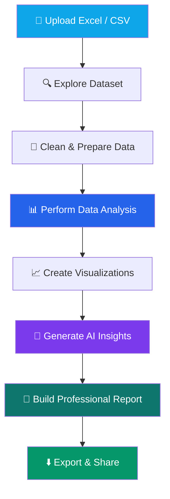

 <p align="center">
  
</p>

<p align="center">
  <strong>AI-POWERED DATA ANALYTICS & AUTOMATED REPORTING PLATFORM</strong>
</p>

<p align="center">
  Transform raw spreadsheets into meaningful insights, interactive visualizations, and professional business reports.
</p>

<p align="center">
  
  
  
</p>

<p align="center">
  <a href="https://www.linkedin.com/in/shuvo-kundu/">
    
  </a>
  <a href="https://github.com/mlwithshuvo7">
    
  </a>
</p>

---

## 📊 Overview

**ClientReport AI** is an AI-powered data analytics and automated reporting platform designed to make business intelligence simpler, faster, and more accessible.

It aims to transform ordinary Excel and CSV files into actionable business insights through data cleaning, statistical analysis, interactive visualizations, AI-assisted explanations, and professional report generation.

Our vision is simple:

> **Upload your data. Discover insights. Generate professional reports.**

---

## ✨ Key Features

<table>
<tr>
<td width="50%">

### 📂 Smart Data Import
- Excel and CSV support
- Dataset preview
- Column and data-type detection
- Data validation

</td>
<td width="50%">

### 🧹 Data Cleaning
- Missing value detection
- Duplicate identification
- Data type correction
- Formatting and consistency checks

</td>
</tr>
<tr>
<td width="50%">

### 📈 Advanced Analytics
- Descriptive statistics
- KPI calculations
- Trend analysis
- Correlation analysis
- Grouped summaries

</td>
<td width="50%">

### 📊 Interactive Visualizations
- Bar charts
- Line charts
- Pie charts
- Area charts
- Scatter plots
- Histograms

</td>
</tr>
<tr>
<td width="50%">

### 🤖 AI-Powered Insights
- Automated findings
- Trend explanations
- Analytical summaries
- Recommendations based on computed results

</td>
<td width="50%">

### 📄 Professional Reports
- PDF report generation
- Custom report templates
- KPI summaries
- Charts and findings
- Export options

</td>
</tr>
</table>

---

## 🔄 How It Works



---

## 🛠️ Technology Stack

<p align="center">
  
</p>

| Category | Technologies |
|---|---|
| Frontend | Next.js, React.js, TypeScript |
| UI & Styling | Tailwind CSS, shadcn/ui, Lucide |
| Data Processing | DuckDB-WASM, PapaParse, SheetJS |
| Analytics | Statistical Analysis, Data Processing |
| Visualization | Recharts |
| Report Generation | jsPDF, pdf-lib |
| Backend | Next.js API Routes |
| Database | Supabase, PostgreSQL |
| Authentication | Supabase Auth |
| Deployment | Vercel |

<sub>Technology choices represent the planned architecture; implementation may evolve during development.</sub>

---

## 🖥️ Application Modules

| Module | Purpose |
|---|---|
| Dashboard | Project overview and analytical activity |
| Data Explorer | Inspect uploaded datasets |
| Cleaning Studio | Prepare and improve data quality |
| Analysis Studio | Calculate statistics and discover patterns |
| Visualization Studio | Create interactive charts |
| AI Insights | Explain analytical findings |
| Report Builder | Design and export reports |
| Project Manager | Organize analysis projects |
| License Manager | Manage software activation |

---

## 📁 Project Structure

```text
clientreport-ai/
│
├── public/
│   ├── logo.svg
│   └── images/
│
├── src/
│   ├── app/
│   │   ├── dashboard/
│   │   ├── upload/
│   │   ├── analysis/
│   │   ├── reports/
│   │   ├── pricing/
│   │   ├── license/
│   │   └── api/
│   │
│   ├── components/
│   │   ├── dashboard/
│   │   ├── charts/
│   │   ├── upload/
│   │   ├── reports/
│   │   └── ui/
│   │
│   ├── lib/
│   │   ├── analytics/
│   │   ├── cleaning/
│   │   ├── visualization/
│   │   ├── reporting/
│   │   ├── licensing/
│   │   └── validation/
│   │
│   ├── hooks/
│   ├── types/
│   └── utils/
│
├── tests/
├── docs/
├── .env.example
├── package.json
└── README.md
```

---

## 🚀 Getting Started

### Prerequisites

- Node.js (LTS recommended)
- npm
- Git

### Installation

**1. Clone the repository**

```bash
git clone https://github.com/mlwithshuvo7/clientreport-ai.git
```

**2. Open the project directory**

```bash
cd clientreport-ai
```

**3. Install dependencies**

```bash
npm install
```

**4. Configure environment variables**

Create `.env.local` based on `.env.example`.

Add the required development configuration. Never expose private API keys or credentials.

**5. Start the development server**

```bash
npm run dev
```

Open `http://localhost:3000` in your browser.

> **Note:** Installation instructions will be finalized alongside the initial working application release.

---

## 🔐 Security & Privacy

Customer data protection is a core design priority.

- Browser-based data processing by default.
- Secure authentication and authorization.
- Server-side validation for sensitive operations.
- Database Row Level Security (RLS).
- Protected environment variables and API credentials.
- File validation and upload restrictions.
- No unnecessary storage of customer datasets.
- Secure payment verification and license activation.

Security testing will be performed throughout development. No application can be guaranteed completely secure.

---

## 🗺️ Development Roadmap

- [x] Product concept and planning
- [x] Initial technology stack selection
- [x] Product architecture planning
- [ ] Premium UI/UX implementation
- [ ] Authentication system
- [ ] Excel and CSV data import
- [ ] Data cleaning engine
- [ ] Statistical analysis engine
- [ ] Interactive visualization engine
- [ ] AI-powered insights
- [ ] Professional PDF report builder
- [ ] Project management
- [ ] License activation system
- [ ] Security and performance testing
- [ ] Production deployment

---

## 🎯 Who Is It For?

- Freelance Data Analysts
- Small Business Owners
- Marketing Agencies
- E-commerce Businesses
- Business Consultants
- Data Analytics Professionals

---

## 👨‍💻 Meet the Creator

<p align="center">
  
</p>

<p align="center">
  <strong>Software Developer | Data Analytics & AI Enthusiast | Technology Innovator</strong>
</p>

ClientReport AI is an independent software product created by **Shuvo Kundu**, with a vision to simplify data analytics and make intelligent business reporting accessible to everyone.

I believe technology should transform complex problems into simple, meaningful solutions.

<p align="center">
  <a href="https://www.linkedin.com/in/shuvo-kundu/">
    
  </a>
  <a href="https://github.com/mlwithshuvo7">
    
  </a>
</p>

---

## 📜 License

ClientReport AI is currently a proprietary software project under development.

All rights reserved. No permission is granted for unauthorized copying, redistribution, or commercial use.

---

<p align="center">
  
</p>

<p align="center">
  <strong>CLIENTREPORT AI</strong>
  <br/>
  Created & Developed by <strong>Shuvo Kundu</strong>
  <br/><br/>
  <sub>© 2026 Shuvo Kundu. All Rights Reserved.</sub>
</p>
